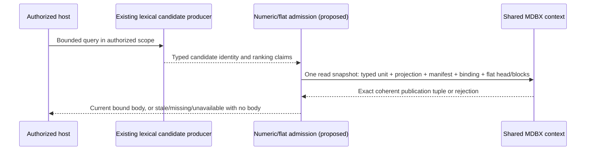

# ADR: Opt-in Numeric Product Publication

Status: **PROPOSED; review required, not implemented** (2026-11-21).
Owner: storage/ingestion/retrieval integration.
Runtime baseline: `main@acd5ad5545386b3feeaa79f8a587855b60801b4d`.
This ADR is a scoped implementation proposal, not permission to change persisted
schemas, activate defaults, migrate databases or merge this PR.

## Context and decision

The [source audit](storage-product-integration-audit.md) identifies two real but
separate integrations: recoverable Raw Markdown publication/retrieval through
legacy KU/CAS authorities, and experimental numeric/flat storage. The existing
fixture consumer composes these honestly, but does not establish one numeric
product currentness/recovery contract.

Propose **B: bounded coordinated publication in one opt-in MDBX context**, using
existing flat, typed, projection and manifest primitives. Add only the coarse
operation and transaction/binding seams necessary for this invariant:

> A result advertised as current must match the authorized scope, active
> canonical head, exact canonical/body identity, typed KU occurrence and
> published projection/resource generation at one declared read snapshot.

This is not a generic coordinator, job runtime, database facade or distributed
transaction manager. The first profile admits **new empty databases only**.
Existing C1/legacy/Raw Markdown APIs and wire bytes stay unchanged. File CAS, if
retained, remains an independent verified durability domain.

Implementation is blocked pending review of the new durable binding/intent
contract and backend transaction seams. Under the current no-schema-change
instruction, this PR delivers the exact proposal and acceptance matrix rather
than implementing a weaker path and calling it qualified.

## Alternatives

| Property | A. Minimal host composition | B. Scoped publication operation |
| --- | --- | --- |
| Reuse | Existing typed/flat adapters, generic lexical producer, host metadata joins | Same primitives plus narrow backend-owned transaction seams |
| Existing evidence | Real flat Markdown consumer and fresh-process reopen | No implementation claimed |
| Typed current admission | Current Raw facade/hydrator instantiate legacy KU stores; a generic candidate producer alone is insufficient | Typed KU, flat head, mapping, manifest and projection read in one snapshot |
| Durable canonical/publication relationship | Arbitrary host metadata, separate writes | Exact, versioned binding owned by one operation |
| Interruption after edit | Host must reconstruct missing work; no intent owns the full tuple | Atomic canonical change + durable pending intent, bounded replay |
| Writers | Could be restricted to a single host-controlled quiescent writer, with a weaker documented contract | Expected-revision/fence checks inside MDBX writers; competing instances covered |
| Cost | Smallest demonstration; cannot claim the requested full acceptance contract without additional proof | Additional reviewed schema/API boundary and recovery controls |

A is valid for a deliberately weaker, quiesced experiment. It is not rejected
as universally impossible: a separately proved monotonic double-collect or
different host protocol could change the decision. No such full protocol is
currently implemented or qualified. B is selected for review because the
requested multiwriter/fresh-process failure contract needs an explicit durable
owner, and the backend architecture already requires coherent same-context
domain reads. Review may choose a smaller protocol only with equivalent gates.

## Identity and authority

Keep these identities separate:

- Portable logical `DocumentId`, `ContentBlockId` and source revision/digest.
- Physical `DocumentStorageId` / `BlockStorageId` in a declared mapping domain.
- `KnowledgeUnitId` occurrence in the **typed** KU family. Equal numbers in a
  legacy family are not aliases or migration mappings.
- Canonical document revision, block revision, resource generation, unit
  revision and projection/derivation revision. Never assume their equality.
- Scope and authorization. The host authenticates the caller and provides the
  permitted scope set. Storage verifies the bound scope; strings supplied by a
  caller are not credentials. Revocation policy must be checked at admission.

Proposed immutable binding tuple (DTO names illustrative, not public API):

```text
CanonicalPublicationRef
  profile/namespace identity
  scope_id + resource_id
  logical document_id + exact document_revision
  materialization/segmentation recipe identity
  complete canonical body digest (algorithm + bytes)
  exact block locators and block revisions where applicable
  typed unit_id + unit_revision + immutable content key
  resource generation + Original projection version/derivation
  publication generation/fence + terminal publication state
```

A binding must be lossless, deterministically encoded and validated against
authoritative rows. The full digest, not a short display anchor, binds bytes.
Physical encoding generations do not alter logical identity. A new context
cannot inherit another context's numeric addresses by numeric equality.

Do not overload `SourceRefSummary` or arbitrary `Metadata` strings with hidden
authority. Its current resource-bound quote contract remains intact. Review a
separate versioned binding/locator contract before choosing a persisted layout.
Document deletion/withdrawal also requires an explicit authoritative tombstone;
there is no existing flat document-delete operation to silently repurpose.

## Backend and transaction boundary

All first-profile MDBX stores share one checked `MdbxStorageContext` and an
explicit profile/namespace. Same filesystem path is insufficient. No generic
`ITransaction` is added to dependency-free domain/storage interfaces.

Required additive infrastructure seams, names provisional:

1. Typed `find`/checked write/allocate and flat current/revision/block reads
   accepting an active transaction from the exact connection.
2. A coarse backend operation that applies the existing expected-revision flat
   edit plus pending publication intent in one writer. It must reuse canonical
   validation and immutable-version logic, not copy codecs or bypass no-reuse.
3. Conditional final publication of prepared typed units, Original projections,
   resource/ownership binding and terminal intent state in one writer. Re-read
   canonical head, expected fence and scope binding inside that writer.
4. A backend-owned read operation that invokes existing Original admission
   logic with typed readers and validates the canonical binding in one snapshot.

Mapping/projection/manifest transaction overloads already exist; reuse them.
The generic `ProjectionAwareLexicalRetriever` remains candidate production.
Adapt the existing snapshot admission helper for typed reads rather than write
another lexical ranking implementation. Candidate budgets and no-refill
semantics remain explicit. The Raw CAS article hydrator remains its own profile;
flat-backed hydration must name its canonical locator and exact byte recipe.

No provider SDK, Markdown parser framework, background scheduler, new graph
backend or compact scorer is required by this operation.

## Publication sequence and observable success

Proposed host-facing phases are `Rejected`, `CommittedPendingPublication`,
`Published` and `Conflict`/`Unavailable`. They are not replacements for existing
`CanonicalEditStatus` or `RawMarkdownProductImportStatus` values.
`CanonicalEditStatus::Ok` continues to mean only that canonical edit's contract.
The new product operation reports `Published` only after its final guarded
publication commit. Lost acknowledgments are resolved by exact intent replay.

```mermaid
sequenceDiagram
    participant H as Authorized host
    participant O as Scoped publication operation (proposed)
    participant D as Shared MDBX context
    participant P as Existing projection preparation
    H->>O: Edit(document, expected revision, idempotency key, authorized scope)
    O->>D: Writer: check scope/head/fence; canonical edit + pending intent
    D-->>O: Commit canonical revision and intent together
    O-->>H: CommittedPendingPublication (if not completed synchronously)
    O->>P: Prepare bounded units/projections for exact committed bytes
    P-->>O: Prepared tuple with full identity/digests/recipe
    O->>D: Writer: recheck head/fence/scope; publish tuple + complete intent
    D-->>O: Commit (or conflict/rollback)
    O-->>H: Published at this commit, or explicit non-published result
```

Parsing, tokenization and large index building happen outside the writer. The
durable intent must retain or address sufficient immutable input to replay
without asking a connector for a newer source. Body budgets, intent count,
batch sizes, lease/fence ownership and replay work limits must be reviewed
before implementation; unknown/unbounded values are not implicit defaults.
The operation must admit bounds before allocations and before the first write.

Duplicate publication with the same operation key and identical canonical
identity returns the existing terminal receipt. Changed scope, payload, recipe
or expected revision under that key conflicts. Committed/published identities,
including subsequently retired or withdrawn identities, are never reassigned.
An allocation rolled back before any commit is not a published identity and
may be discarded with its transaction; this preserves the current mapping
allocator's rollback contract. A superseded pending revision cannot become
current merely because a delayed worker eventually finishes.

## Read and hydration sequence



The read snapshot is the operation's linearization point. A subsequent commit
does not retroactively invalidate that observation. A new read after the commit
must see the new tuple or reject while publication is pending. Ranking remains
bounded candidate production, not necessarily snapshot-consistent current top-K.
Do not silently refill stale candidates to hide incomplete admission.

For external CAS bytes, follow the existing bounded pattern: observe exact
metadata, verify the complete object's digest under its separate byte budget,
then revalidate all authority (including the flat binding) in a final snapshot.
Only the verified owned bytes may escape. CAS and MDBX do not share an atomic
commit; missing/corrupt/changed metadata fails closed. A retained raw artifact
and normalized canonical rendering must not be claimed byte-identical unless
the named materialization profile establishes that fact.

Historical reads explicitly request one exact authorized revision and recipe.
They may remain available after current publication changes, but are labelled
historical, not current. Missing retained data is reported, never silently
substituted by a newer block, URI download or projection text.

## Failure, replay and atomicity matrix

Every result below is a proposed acceptance requirement. It has not been
established merely by this design document.

| Injection / observation | Durable state and permitted result | Recovery / negative assertion |
| --- | --- | --- |
| Invalid input / budget | No write or ID allocation | Reject before side effects; no body |
| Failed canonical commit | Old canonical/publication state, no new intent | Old exact result may remain; no false new success |
| Death before canonical+intent commit | Writer rolled back | Reopen unchanged; retry same key once |
| Death after canonical+intent commit | New canonical plus pending intent, old index may exist | Current admission rejects old tuple; bounded replay uses pinned input |
| Failed projection/index preparation | Pending intent, no new active tuple | No product success; retry within declared budget |
| Partial staging | Never visible as terminal publication | Read requires complete committed binding; orphan rows are not publication |
| Death before final commit | Final writer rolled back | Replay exact tuple; no duplicate allocation/publication |
| Death after final commit / lost reply | Terminal tuple and receipt committed | Idempotent replay returns receipt; fresh process reads same tuple |
| Newer canonical edit during preparation | Recheck fails | Superseded work cannot publish as current |
| Duplicate key / changed payload | No competing publication under same identity | Exact replay only; changed data conflicts |
| Concurrent expected-head writers | At most one wins canonical writer | Loser conflicts; unrelated IDs/revisions remain intact |
| Wrong/revoked scope | No authorized final admission | No body, private preview or cross-scope fallback |
| Missing mapping / attempted reuse | Inconsistent or retired identity | Reject; never allocate during reads or remap silently |
| Corrupted digest / missing historical block | Exact tuple cannot be verified | No body; preserve corruption diagnosis |
| Malformed/unknown marker | Namespace cannot be admitted | Refuse open/write, retain original bytes |
| Cross-document block spelling collision | Mapping is document-qualified | Distinct physical mappings; cross-document locator rejected |

Same-context canonical+intent and terminal publication are separate atomic
commits, not one transaction covering the whole operation. Between them,
availability may be reduced by fail-closed admission. An API promising an
always-readable old snapshot throughout that gap would be a different contract.
Across environments, external indexes or CAS there is no shared transaction.

Replay is bounded and host-invoked, not a new scheduler. A fenced, expired-owner
takeover needs an exact transaction-checked token as in existing importer work;
a local mutex or timestamp alone does not authorize recovery. Rollback after a
canonical commit does not delete immutable history or reuse IDs: either finish
publication or record an explicit abandoned/withdrawn outcome. Reverting content
is a new canonical edit. Garbage collection requires a separate retention gate.

## Phase 3 implementation proposal and gates

After review and explicit schema/API authorization, implement in a small Draft
PR using the existing product/lexical interfaces, not a fake retrieval:

1. Create a new empty MDBX environment and isolated temporary CAS root if used.
2. Import a committed real Markdown fixture under a named bounded parse recipe.
3. Create canonical revision zero and exact materialization digest.
4. Persist mapping and typed KU metadata under the reviewed binding.
5. Prepare/publish Original/index representations through existing interfaces.
6. Search with the normal bounded lexical producer.
7. Admit/hydrate through one coherent numeric/flat authority operation.
8. Edit one block against its expected canonical revision.
9. Delete another block without recycling its identity.
10. Republish the new exact tuple, including changed body/provenance identity.
11. Query old/new distinctive terms; no stale or unauthorized bytes escape.
12. Exit the process normally and at each injected publication boundary.
13. Reopen in a fresh process with the same explicit profile.
14. Check mapping, independent revision counters, digest, provenance, scope and
    retrieval against expected source-bound assertions.
15. Read exact historical revisions and reject historical block-ID reuse.

Implement every negative row above, including canonical/index failure, death
before/after both commits, stale revision, duplicate publication, bad digest,
missing mapping, reuse, scope, historical absence, marker, cross-document
collision and writer conflict. Every negative current-read case asserts both
non-current status and absence of payload/preview. Test process timeouts bound
failure paths, including thread joins; use isolated TMP/TEMP and serial MDBX
CTest where fixtures would otherwise collide.

Run focused tests, MDBX ON/OFF C++17 Release/Debug, numeric conformance,
installed consumers and exact-head CI at each implementation PR. Do not rename
the earlier 570-execution or historical benchmark receipts as new qualification.
No general performance claim, default activation, real migration or release
follows from passing this opt-in acceptance matrix.

## Review checklist and next change

The first implementation PR should contain only the transaction/read seams and
their provenance/no-ownership-transfer tests, without a new serving default.
The next reviewed step defines the binding/intent's codec, DBI budget, resource
limits and canonical digest recipe; only then implement publication/recovery.
The final slice uses those seams for end-to-end/fresh-process qualification.

Review must settle: durable input availability for replay; exact scope/resource
ownership and revocation point; bounded transaction size; intent retention and
fencing; new-record version rejection; deletion/withdrawal semantics. These are
specific architecture prerequisites, not a request to restart a general storage
framework audit. The separate [migration plan](storage-numeric-migration-plan.md)
remains design only until an actual OLD profile and exporter are qualified.
